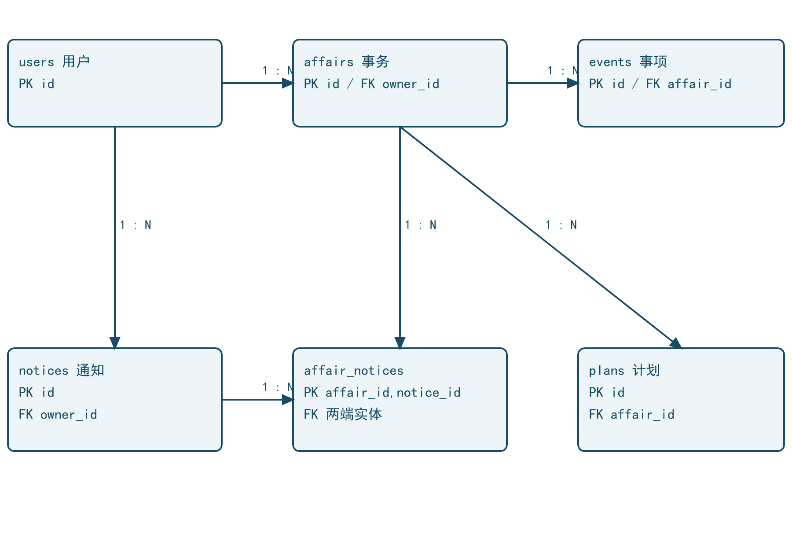
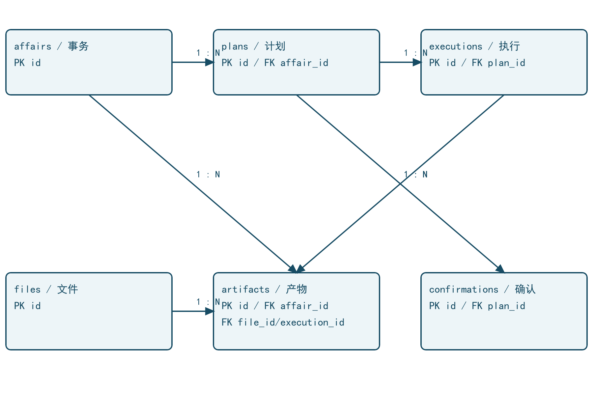

# Milk Dragon_数据库设计说明书

版本3.1 / 2026-11-21 / 设计稿

## Milk Dragon 数据库设计说明书

版本3.1 / 2026年11月21日 / 设计评审稿

目录：1引言；2设计决策；3概念ER；4关系与映射；5数据字典；6事务完整性；7索引容量；8安全恢复；9追踪验证。

附件schema.sql为可执行设计基线，已在内存SQLite中验证建表，不代表线上数据库已迁移。

## 1 引言、参考与术语

参考：GB/T 8567—2006《计算机软件文档编制规范》。国家标准平台：https://openstd.samr.gov.cn/bzgk/std/newGbInfo?hcno=84C42B6277D2714B7176B10C6E6B1A44 。按系统/子系统设计与数据库顶层设计主题裁剪组织，未声称逐条符合性认证。公开需求基线为第一次作业博客https://www.cnblogs.com/embrace897/p/23594772（2026-11-21核对），沿用FR01—20及原优先级；V2.0报告为辅助材料；本设计为V3.1候选稿。

UML（Unified Modeling Language，统一建模语言）；ER（Entity Relationship，实体关系）；API（Application Programming Interface，应用程序接口）；RAG（Retrieval-Augmented Generation，检索增强生成）；MCP（Model Context Protocol，模型上下文协议）；Skill（场景处理规范）；PK（Primary Key，主键）；FK（Foreign Key，外键）；ORM（Object Relational Mapping，对象关系映射）；DDL（Data Definition Language，数据定义语言）；UTC（Coordinated Universal Time，协调世界时）；WAL（Write-Ahead Logging，预写日志）；CAS（Compare And Set，比较并更新）；JSON（JavaScript Object Notation，数据交换表示）。

业务库管理身份、通知、计划、执行、提醒、记忆与公共资料。文件正文在受控存储，表保存定位；检索索引是可重建派生数据。

## 2 设计决策与规范

采用SQLite关系模型，开启外键与WAL。内部ID采用服务端生成的文本标识；created_at默认数据库时间。UTC精确时间统一使用带Z的文本格式，日期型使用YYYY-MM-DD并记录时区。

表名为snake_case，实体类为PascalCase。主表与关联表规范化；仅可变计划、差异和证据使用JSON字段，服务端按固定模式校验。禁止从JSON字段动态拼接SQL。

所有者一致性由事务内服务校验，单独外键不能防止跨用户关联。任何关联通知、事务、文件时必须核对两端所属范围；核心测试覆盖跨用户关联。

## 3 概念ER模型

连线以1:N标识基数；通知与事务为多对多，由关联表消解。其余执行、材料、资料与记忆关系在关系模型中定义。

图为核心概念子集，完整实体以DDL及数据字典为准，不能据图省略确认与审计。

## 4 关系数据模型与ORM映射

| 实体类 | 关系表 | 关系/映射规则 |
|---|---|---|
| Users | users | 字段直接映射；JSON经校验序列化 |
| Files | files | 字段直接映射；JSON经校验序列化 |
| Notices | notices | 字段直接映射；JSON经校验序列化 |
| Drafts | drafts | 字段直接映射；JSON经校验序列化 |
| Affairs | affairs | 字段直接映射；JSON经校验序列化 |
| AffairNotices | affair_notices | 字段直接映射；JSON经校验序列化 |
| Events | events | 字段直接映射；JSON经校验序列化 |
| ChecklistItems | checklist_items | 字段直接映射；JSON经校验序列化 |
| Plans | plans | 字段直接映射；JSON经校验序列化 |
| Confirmations | confirmations | 字段直接映射；JSON经校验序列化 |
| Executions | executions | 字段直接映射；JSON经校验序列化 |
| Reminders | reminders | 字段直接映射；JSON经校验序列化 |
| KnowledgeDocuments | knowledge_documents | 字段直接映射；JSON经校验序列化 |
| KnowledgeChunks | knowledge_chunks | 字段直接映射；JSON经校验序列化 |
| MemoryItems | memory_items | 字段直接映射；JSON经校验序列化 |
| Changes | changes | 字段直接映射；JSON经校验序列化 |
| AuditLogs | audit_logs | 字段直接映射；JSON经校验序列化 |
| EventSources | event_sources | 字段直接映射；JSON经校验序列化 |
| Artifacts | artifacts | 字段直接映射；JSON经校验序列化 |

每张表PK唯一，affair_notices使用联合PK。应用层Repository负责显式查询映射，不要求额外引入重型ORM。关系与数据字典是映射规范，尚非已实现模型代码。

## 5 数据字典 / users

| 字段 | 类型与约束 | 含义 |
|---|---|---|
| id | TEXT PRIMARY KEY | 内部用户标识 |
| wx_subject | TEXT NOT NULL UNIQUE | 平台身份映射，禁止客户端指定 |
| role | TEXT NOT NULL CHECK(role IN ('student','maintainer','admin')) | 角色 |
| status | TEXT NOT NULL DEFAULT 'active' | 账号状态 |
| created_at | TEXT NOT NULL DEFAULT CURRENT_TIMESTAMP | 创建时间 |

附加约束：无表级附加约束；以DDL和业务校验为准。

逻辑删除：通知、记忆和资料先标记状态，检索排除；原件及副本按保留政策清理。中间步骤记录不以删除方式规避审计。

## 5 数据字典 / files

| 字段 | 类型与约束 | 含义 |
|---|---|---|
| id | TEXT PRIMARY KEY | 实体标识 |
| owner_id | TEXT NOT NULL REFERENCES users(id) | 所属用户 |
| storage_key | TEXT NOT NULL UNIQUE | 存储定位，不是公开链接 |
| sha256 | TEXT NOT NULL | 内容摘要 |
| mime | TEXT NOT NULL | 核验的格式 |
| size_bytes | INTEGER NOT NULL CHECK(size_bytes>=0) | 文件大小 |
| created_at | TEXT NOT NULL DEFAULT CURRENT_TIMESTAMP | 创建时间 |

附加约束：无表级附加约束；以DDL和业务校验为准。

逻辑删除：通知、记忆和资料先标记状态，检索排除；原件及副本按保留政策清理。中间步骤记录不以删除方式规避审计。

## 5 数据字典 / notices

| 字段 | 类型与约束 | 含义 |
|---|---|---|
| id | TEXT PRIMARY KEY | 实体标识 |
| owner_id | TEXT NOT NULL REFERENCES users(id) | 所属用户 |
| file_id | TEXT REFERENCES files(id) | 附件可空，文本通知无附件 |
| source | TEXT NOT NULL | 来源描述 |
| published_at | TEXT | 发布时间，可空 |
| raw_text | TEXT | 原文 |
| status | TEXT NOT NULL DEFAULT 'pending' | 解析状态 |
| revision | INTEGER NOT NULL DEFAULT 1 | 版本 |
| created_at | TEXT NOT NULL DEFAULT CURRENT_TIMESTAMP | 创建时间 |

附加约束：无表级附加约束；以DDL和业务校验为准。

逻辑删除：通知、记忆和资料先标记状态，检索排除；原件及副本按保留政策清理。中间步骤记录不以删除方式规避审计。

## 5 数据字典 / drafts

| 字段 | 类型与约束 | 含义 |
|---|---|---|
| id | TEXT PRIMARY KEY | 草稿标识 |
| notice_id | TEXT NOT NULL REFERENCES notices(id) | 所属通知 |
| revision | INTEGER NOT NULL | 草稿版本 |
| fields_json | TEXT NOT NULL | 字段值及明确/推导/缺项状态 |
| evidence_json | TEXT NOT NULL | 原文片段/页码/可选区域 |
| created_at | TEXT NOT NULL DEFAULT CURRENT_TIMESTAMP | 创建时间 |

附加约束：UNIQUE(notice_id,revision)

逻辑删除：通知、记忆和资料先标记状态，检索排除；原件及副本按保留政策清理。中间步骤记录不以删除方式规避审计。

## 5 数据字典 / affairs

| 字段 | 类型与约束 | 含义 |
|---|---|---|
| id | TEXT PRIMARY KEY | 实体标识 |
| owner_id | TEXT NOT NULL REFERENCES users(id) | 所属用户 |
| title | TEXT NOT NULL | 事务标题 |
| status | TEXT NOT NULL DEFAULT 'preparing' | 事务状态 |
| revision | INTEGER NOT NULL DEFAULT 1 | 版本 |
| created_at | TEXT NOT NULL DEFAULT CURRENT_TIMESTAMP | 创建时间 |

附加约束：无表级附加约束；以DDL和业务校验为准。

逻辑删除：通知、记忆和资料先标记状态，检索排除；原件及副本按保留政策清理。中间步骤记录不以删除方式规避审计。

## 5 数据字典 / affair_notices

| 字段 | 类型与约束 | 含义 |
|---|---|---|
| affair_id | TEXT NOT NULL REFERENCES affairs(id) | 事务 |
| notice_id | TEXT NOT NULL REFERENCES notices(id) | 通知 |
| created_at | TEXT NOT NULL DEFAULT CURRENT_TIMESTAMP | 创建时间 |

附加约束：PRIMARY KEY(affair_id,notice_id)

逻辑删除：通知、记忆和资料先标记状态，检索排除；原件及副本按保留政策清理。中间步骤记录不以删除方式规避审计。

## 5 数据字典 / events

| 字段 | 类型与约束 | 含义 |
|---|---|---|
| id | TEXT PRIMARY KEY | 实体标识 |
| owner_id | TEXT NOT NULL REFERENCES users(id) | 所属用户 |
| affair_id | TEXT NOT NULL REFERENCES affairs(id) | 所属事务 |
| title | TEXT NOT NULL | 标题 |
| kind | TEXT NOT NULL CHECK(kind IN ('activity','deadline','step')) | 类型 |
| due_at | TEXT | UTC时间，可空 |
| date_value | TEXT | 日期型值，可空 |
| precision | TEXT NOT NULL CHECK(precision IN ('date','minute','unknown')) | 时间精度 |
| timezone | TEXT NOT NULL DEFAULT 'Asia/Shanghai' | 展示时区 |
| status | TEXT NOT NULL DEFAULT 'todo' | 事项状态 |
| revision | INTEGER NOT NULL DEFAULT 1 | 并发版本 |
| start_at | TEXT | 活动开始UTC时间 |
| end_at | TEXT | 活动结束UTC时间，可空但不能擅自推断时长 |
| created_at | TEXT NOT NULL DEFAULT CURRENT_TIMESTAMP | 创建时间 |

附加约束：CHECK((precision='date' AND date_value IS NOT NULL AND due_at IS NULL) OR (precision='minute' AND due_at IS NOT NULL AND date_value IS NULL) OR (precision='unknown' AND due_at IS NULL AND date_value IS NULL)); CHECK(end_at IS NULL OR (start_at IS NOT NULL AND end_at>start_at)); CHECK(kind='activity' OR (start_at IS NULL AND end_at IS NULL))

逻辑删除：通知、记忆和资料先标记状态，检索排除；原件及副本按保留政策清理。中间步骤记录不以删除方式规避审计。

## 5 数据字典 / checklist_items

| 字段 | 类型与约束 | 含义 |
|---|---|---|
| id | TEXT PRIMARY KEY | 条目标识 |
| affair_id | TEXT NOT NULL REFERENCES affairs(id) | 事务 |
| title | TEXT NOT NULL | 材料或准备步骤 |
| done | INTEGER NOT NULL DEFAULT 0 CHECK(done IN (0,1)) | 完成状态 |
| created_at | TEXT NOT NULL DEFAULT CURRENT_TIMESTAMP | 创建时间 |

附加约束：无表级附加约束；以DDL和业务校验为准。

逻辑删除：通知、记忆和资料先标记状态，检索排除；原件及副本按保留政策清理。中间步骤记录不以删除方式规避审计。

## 5 数据字典 / plans

| 字段 | 类型与约束 | 含义 |
|---|---|---|
| id | TEXT PRIMARY KEY | 实体标识 |
| owner_id | TEXT NOT NULL REFERENCES users(id) | 所属用户 |
| affair_id | TEXT NOT NULL REFERENCES affairs(id) | 事务 |
| revision | INTEGER NOT NULL | 计划版本 |
| operations_json | TEXT NOT NULL | 动作和目标版本快照 |
| status | TEXT NOT NULL DEFAULT 'draft' | 计划状态 |
| created_at | TEXT NOT NULL DEFAULT CURRENT_TIMESTAMP | 创建时间 |

附加约束：无表级附加约束；以DDL和业务校验为准。

逻辑删除：通知、记忆和资料先标记状态，检索排除；原件及副本按保留政策清理。中间步骤记录不以删除方式规避审计。

## 5 数据字典 / confirmations

| 字段 | 类型与约束 | 含义 |
|---|---|---|
| id | TEXT PRIMARY KEY | 确认标识 |
| plan_id | TEXT NOT NULL REFERENCES plans(id) | 确认计划 |
| plan_revision | INTEGER NOT NULL | 确认版本 |
| actor_id | TEXT NOT NULL REFERENCES users(id) | 确认人 |
| digest | TEXT NOT NULL | 操作摘要 |
| consumed | INTEGER NOT NULL DEFAULT 0 CHECK(consumed IN (0,1)) | 是否消费 |
| created_at | TEXT NOT NULL DEFAULT CURRENT_TIMESTAMP | 创建时间 |

附加约束：UNIQUE(plan_id,plan_revision)

逻辑删除：通知、记忆和资料先标记状态，检索排除；原件及副本按保留政策清理。中间步骤记录不以删除方式规避审计。

## 5 数据字典 / executions

| 字段 | 类型与约束 | 含义 |
|---|---|---|
| id | TEXT PRIMARY KEY | 执行标识 |
| plan_id | TEXT NOT NULL REFERENCES plans(id) | 所属计划 |
| step_key | TEXT NOT NULL UNIQUE | 稳定步骤幂等键 |
| tool | TEXT NOT NULL | 工具标识 |
| status | TEXT NOT NULL DEFAULT 'queued' | 执行状态 |
| result_json | TEXT | 结果或错误摘要 |
| lease_until | TEXT | 执行租约到期 |
| created_at | TEXT NOT NULL DEFAULT CURRENT_TIMESTAMP | 创建时间 |

附加约束：无表级附加约束；以DDL和业务校验为准。

逻辑删除：通知、记忆和资料先标记状态，检索排除；原件及副本按保留政策清理。中间步骤记录不以删除方式规避审计。

## 5 数据字典 / reminders

| 字段 | 类型与约束 | 含义 |
|---|---|---|
| id | TEXT PRIMARY KEY | 提醒标识 |
| event_id | TEXT NOT NULL REFERENCES events(id) | 对应事项 |
| fire_at | TEXT NOT NULL | UTC触发时间 |
| status | TEXT NOT NULL DEFAULT 'pending' | 待触发/已产生/取消 |
| read_at | TEXT | 用户阅读时间 |
| created_at | TEXT NOT NULL DEFAULT CURRENT_TIMESTAMP | 创建时间 |

附加约束：无表级附加约束；以DDL和业务校验为准。

逻辑删除：通知、记忆和资料先标记状态，检索排除；原件及副本按保留政策清理。中间步骤记录不以删除方式规避审计。

## 5 数据字典 / knowledge_documents

| 字段 | 类型与约束 | 含义 |
|---|---|---|
| id | TEXT PRIMARY KEY | 资料标识 |
| file_id | TEXT NOT NULL REFERENCES files(id) | 原始资料 |
| institution | TEXT NOT NULL | 机构范围 |
| version | TEXT NOT NULL | 文档版本 |
| source_url | TEXT | 来源 |
| valid_until | TEXT | 有效期 |
| status | TEXT NOT NULL DEFAULT 'draft' | 待审/发布/停用 |
| department | TEXT | 部门范围，可空代表机构级 |
| audience | TEXT NOT NULL DEFAULT 'all' | 适用人群 |
| valid_from | TEXT | 生效时间 |
| index_status | TEXT NOT NULL DEFAULT 'pending' | 索引就绪状态 |
| created_at | TEXT NOT NULL DEFAULT CURRENT_TIMESTAMP | 创建时间 |

附加约束：无表级附加约束；以DDL和业务校验为准。

逻辑删除：通知、记忆和资料先标记状态，检索排除；原件及副本按保留政策清理。中间步骤记录不以删除方式规避审计。

## 5 数据字典 / knowledge_chunks

| 字段 | 类型与约束 | 含义 |
|---|---|---|
| id | TEXT PRIMARY KEY | 分段标识 |
| document_id | TEXT NOT NULL REFERENCES knowledge_documents(id) | 来源文档 |
| ordinal | INTEGER NOT NULL | 段序 |
| content | TEXT NOT NULL | 分段文本 |
| locator | TEXT NOT NULL | 页码或段落定位 |
| created_at | TEXT NOT NULL DEFAULT CURRENT_TIMESTAMP | 创建时间 |

附加约束：UNIQUE(document_id,ordinal)

逻辑删除：通知、记忆和资料先标记状态，检索排除；原件及副本按保留政策清理。中间步骤记录不以删除方式规避审计。

## 5 数据字典 / memory_items

| 字段 | 类型与约束 | 含义 |
|---|---|---|
| id | TEXT PRIMARY KEY | 实体标识 |
| owner_id | TEXT NOT NULL REFERENCES users(id) | 所属用户 |
| content | TEXT NOT NULL | 用户确认的长期信息 |
| source_ref | TEXT NOT NULL | 来源会话或人工输入 |
| revision | INTEGER NOT NULL DEFAULT 1 | 版本 |
| status | TEXT NOT NULL DEFAULT 'proposed' | 提议/有效/停用/删除 |
| created_at | TEXT NOT NULL DEFAULT CURRENT_TIMESTAMP | 创建时间 |

附加约束：无表级附加约束；以DDL和业务校验为准。

逻辑删除：通知、记忆和资料先标记状态，检索排除；原件及副本按保留政策清理。中间步骤记录不以删除方式规避审计。

## 5 数据字典 / changes

| 字段 | 类型与约束 | 含义 |
|---|---|---|
| id | TEXT PRIMARY KEY | 变更标识 |
| affair_id | TEXT NOT NULL REFERENCES affairs(id) | 事务 |
| notice_id | TEXT NOT NULL REFERENCES notices(id) | 补充通知 |
| diff_json | TEXT NOT NULL | 字段差异与影响对象 |
| plan_id | TEXT REFERENCES plans(id) | 调整计划 |
| created_at | TEXT NOT NULL DEFAULT CURRENT_TIMESTAMP | 创建时间 |

附加约束：无表级附加约束；以DDL和业务校验为准。

逻辑删除：通知、记忆和资料先标记状态，检索排除；原件及副本按保留政策清理。中间步骤记录不以删除方式规避审计。

## 5 数据字典 / audit_logs

| 字段 | 类型与约束 | 含义 |
|---|---|---|
| id | TEXT PRIMARY KEY | 审计标识 |
| actor_id | TEXT REFERENCES users(id) | 操作身份 |
| action | TEXT NOT NULL | 动作 |
| target_ref | TEXT NOT NULL | 对象引用 |
| request_id | TEXT NOT NULL | 关联请求 |
| summary | TEXT | 不含完整私人正文的摘要 |
| created_at | TEXT NOT NULL DEFAULT CURRENT_TIMESTAMP | 创建时间 |

附加约束：无表级附加约束；以DDL和业务校验为准。

逻辑删除：通知、记忆和资料先标记状态，检索排除；原件及副本按保留政策清理。中间步骤记录不以删除方式规避审计。

## 5 数据字典 / event_sources

| 字段 | 类型与约束 | 含义 |
|---|---|---|
| event_id | TEXT NOT NULL REFERENCES events(id) | 正式事项 |
| draft_id | TEXT NOT NULL REFERENCES drafts(id) | 保留原始解析版本 |
| field_name | TEXT NOT NULL | 来源字段 |
| evidence_json | TEXT NOT NULL | 原文片段和定位 |
| confirmed_value | TEXT NOT NULL | 人工确认后的字段值 |
| created_at | TEXT NOT NULL DEFAULT CURRENT_TIMESTAMP | 创建时间 |

附加约束：PRIMARY KEY(event_id,draft_id,field_name)

逻辑删除：通知、记忆和资料先标记状态，检索排除；原件及副本按保留政策清理。中间步骤记录不以删除方式规避审计。

## 5 数据字典 / artifacts

| 字段 | 类型与约束 | 含义 |
|---|---|---|
| id | TEXT PRIMARY KEY | 实体标识 |
| owner_id | TEXT NOT NULL REFERENCES users(id) | 所属用户 |
| affair_id | TEXT NOT NULL REFERENCES affairs(id) | 所属事务 |
| execution_id | TEXT NOT NULL REFERENCES executions(id) | 生成步骤 |
| file_id | TEXT NOT NULL REFERENCES files(id) | 真实产物 |
| kind | TEXT NOT NULL | 提纲/材料草稿 |
| status | TEXT NOT NULL DEFAULT 'ready' | 产物状态 |
| created_at | TEXT NOT NULL DEFAULT CURRENT_TIMESTAMP | 创建时间 |

附加约束：UNIQUE(execution_id,file_id)

逻辑删除：通知、记忆和资料先标记状态，检索排除；原件及副本按保留政策清理。中间步骤记录不以删除方式规避审计。

## 6 事务、完整性与并发

创建事务：核对草稿版本→验证所属→写入事务/关联/事项/清单→写审计→提交，失败整体回滚。

确认执行：BEGIN IMMEDIATE→读取并核验计划与目标版本→消费确认→登记唯一步骤→提交；后台再运行工具。内部任务写入及执行成功标记同一事务。

资料发布：核对维护权限与元数据→发布状态→异步建立索引；仅发布且索引就绪资料参与新检索。停用时先禁止检索，索引清理可以异步。

外键RESTRICT为默认删除行为。清除附件前检查引用，删除采用明确顺序；禁止直接级联抹掉审计。日期精度由CHECK约束保证，JSON结构由服务层保证。

## 7 索引、规模与性能

ix_events_due用于用户未完成期限查询；ix_reminders_due用于提醒扫描；ix_executions_claim用于任务领取与租约；ix_notices_owner用于通知箱。唯一键负责幂等、草稿版本和文档段序。

试点假设100用户，每人100通知、每通知平均2MB，原件约20GB；平均5事项/通知约5万事项。该容量为规划估算，不能作为实测。

建议分配至少40GB附件空间并另留备份，数据库容量以真实样本测量。普通读取20并发P95目标2秒；索引通过查询计划与压测验证。

## 8 安全、备份与迁移

用户查询强制owner_id过滤；关联字段所属校验与业务写入同一事务。管理员不自动拥有私人文档检索权限。微信凭证与模型密钥不进入业务表明文和日志。

每日采用SQLite一致性备份接口生成快照，连同文件清单、版本及校验值归档；不可只复制活动主库而遗漏WAL。目标恢复点24小时、恢复时间4小时，需演练。

迁移记录schema版本与校验值；先备份、测试迁移、完整性检查再切换。失败恢复旧版本与快照；运行任务先停领并核对外部结果，不重放不明副作用。

在线数据删除后清除索引与缓存；备份拟保留7天，到期清理，最终保留政策待团队确认。

## 9 验证与需求追踪

本次验证：schema.sql在内存SQLite中成功建表并通过foreign_key_check。并发与业务授权尚未实现，不宣称全部通过。

后续：外键错误插入应拒绝；重复step_key应拒绝；未知日期不写精确时刻；过期计划409；跨用户关联403；备份恢复后数量和附件校验一致。

对应需求：FR01权限；FR02-06通知与事务；FR08资料；FR10执行；FR11提醒；FR13记忆；FR14变更；FR16恢复；FR19删除。

评审未决：真实模型与数据库访问库版本、检索实现、资料发布权限、最终保留期及容量。

## 10 证据链、产物及完整关系

完整关系：users 1:N files/notices/affairs/events/plans/memory_items；affairs N:M notices经affair_notices；notices 1:N drafts；affairs 1:N events/checklist_items/plans/changes/artifacts；events 1:N reminders/event_sources；drafts 1:N event_sources；plans 1:N confirmations/executions；executions 1:N artifacts；files 1:N artifacts/knowledge_documents；knowledge_documents 1:N knowledge_chunks。

相同执行产物重复回调由唯一(execution_id,file_id)拒绝；正式字段保存人工确认值与原文出处。时间约束在表级保证结束晚于开始；无结束时间不补默认时长。

## 11 与公开需求的差异及集成边界

第一次作业公开基线：https://www.cnblogs.com/embrace897/p/23594772。原设计19表扩为19表，新增event_sources与artifacts；不是新增两项用户业务，而是补齐FR04原文核对与FR12真实产物落库。

资料元数据增加department、audience、valid_from、index_status以落实FR08适用范围及有效期。索引落后或资料停用时先排除检索，后台可重建。

身份与MiniClaw工作区建立内部映射，会话/消息复用现有持久化并加事务关联适配；本文19表是校园业务目标模型，不代表可以直接导入底座覆盖旧表。整合迁移必须用独立命名空间或适配仓储，先检查现有表结构。

JSON字段保存操作快照而不复制实时任务状态；时间比较统一UTC格式；本轮仅验证DDL、唯一约束、时间约束与外键，跨用户授权和模型效果仍待实现。
