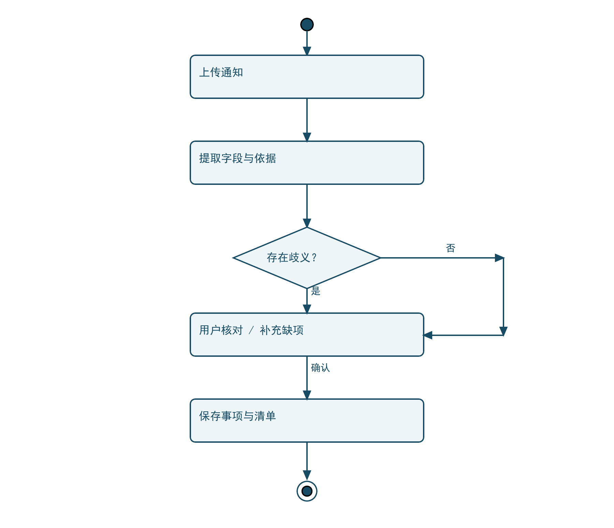
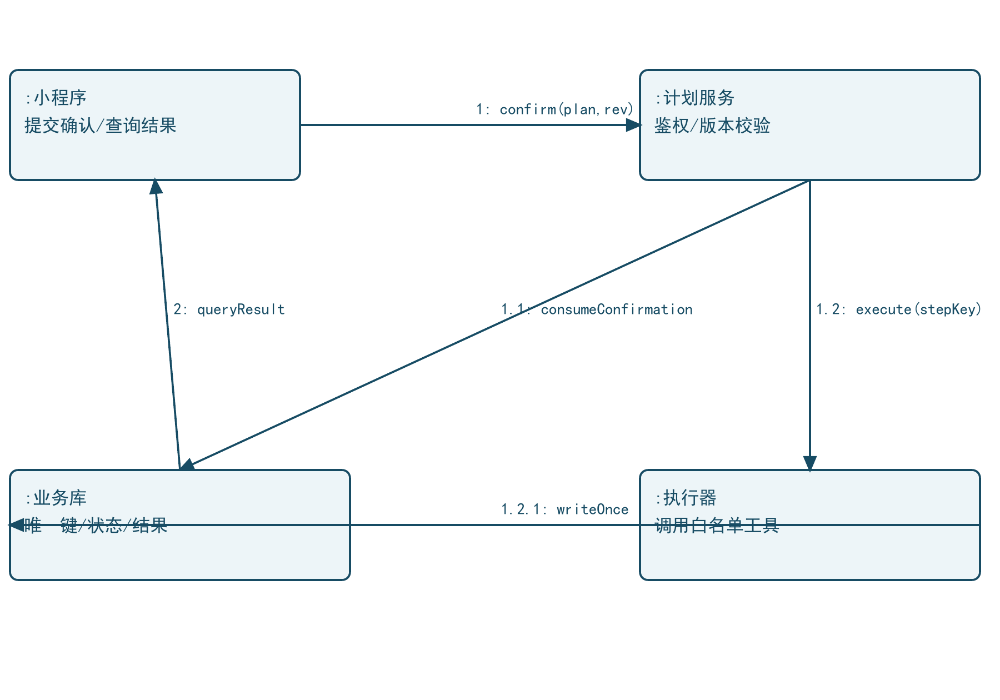

# Milk Dragon_系统设计说明书

版本3.2 / 2026-11-22 / 设计稿

## Milk Dragon 系统设计说明书

文档标识 ZB-SSDD-3.2 / 2026年11月22日 / 设计评审稿

团队：林炳辉（产品文档）、黄国轩（智能体）、吴俊达（前端）、谢嘉鸿（后端）、张志远（测试）。

第一次作业博客已发布，记载30人初步调研与原定分工；原始访谈记录仍待补档。已在即时设计搭建15页可编辑交互原型并开启公开只读预览，2026年11月22日通过Edge无痕窗口验证。业务系统实现、成员贡献及真实协作证据仍需后续完成。

目录：1引言与术语；2设计基线；3架构；4用例；5流程；6类结构；7关键时序；8协作；9接口；10原型规则；11运行安全；12追踪与验证。

## 1 引言、参考与缩略语

参考：GB/T 8567—2006《计算机软件文档编制规范》。国家标准平台：https://openstd.samr.gov.cn/bzgk/std/newGbInfo?hcno=84C42B6277D2714B7176B10C6E6B1A44 。按系统/子系统设计与数据库顶层设计主题裁剪组织，未声称逐条符合性认证。公开需求基线为第一次作业博客https://www.cnblogs.com/embrace897/p/23594772（2026-11-22核对），沿用FR01—20及原优先级；V2.0报告为辅助材料；本设计为V3.2候选稿。

UML（Unified Modeling Language，统一建模语言）；ER（Entity Relationship，实体关系）；API（Application Programming Interface，应用程序接口）；RAG（Retrieval-Augmented Generation，检索增强生成）；MCP（Model Context Protocol，模型上下文协议）；Skill（场景处理规范）；PK（Primary Key，主键）；FK（Foreign Key，外键）；ORM（Object Relational Mapping，对象关系映射）；DDL（Data Definition Language，数据定义语言）；UTC（Coordinated Universal Time，协调世界时）；WAL（Write-Ahead Logging，预写日志）；CAS（Compare And Set，比较并更新）；JSON（JavaScript Object Notation，数据交换表示）。

设计输入：知办需求V2.0；第二次团队作业16785。本文按架构、模块、对象与接口逐层展开。后台管理按本次作业新增设计，小程序仍是唯一学生产品，不新增学生Web。

## 2 基线与总体决策

业务闭环：通知上传、字段核对、事务关联、检索咨询、计划、确认执行、材料与提醒、通知变更、人工办结。

核心场景为竞赛报名、课程材料提交。后台管理原型覆盖资料发布/停用、异常任务和审计；实现优先采用小程序授权管理入口。

采用TypeScript/Hono服务、Pi执行体系及uni-app/Vue小程序。单体分层服务加后台进程，SQLite单实例试点与持久化附件。MiniClaw仅静态评估，复用能力先验证。

不直接执行任意命令，不代缴费、不代外部提交。资料未知时追问。模型调用不持有数据库事务。

## 3 分层架构

表示层只发请求；接入层确定用户与范围；业务层持有规则；智能层提出计划；工具仍经业务服务鉴权；后台按数据库状态处理异步任务。

模块边界：NoticeService处理草稿与依据；AffairService处理事务；PlanService处理确认；Executor处理幂等步骤；KnowledgeService过滤资料；ReminderWorker处理提醒。

## 4 UML用例设计

学生关联通知、咨询、确认计划与查询结果；资料维护员维护公共资料。系统管理员另负责部署配置，不隐式查看私人原文。

关键写入只接受服务端确认记录。普通查询无需逐次确认，用户直接表单保存即为明确操作。

## 5 UML活动设计

初始实心圆、动作圆角框、判断菱形、终止双圆。即使无歧义也经过用户核对；只有确认后才保存正式事项。

解析失败保留通知，支持手动录入。相对时间必须有基准，日期未知不得补成确定值。

## 6 UML类结构

图为核心子集。事务与通知由关联类连接；事务含多个事项；计划含多个执行步骤。完整数据库关系见数据库说明书。

revision用于并发校验，业务对象的ownerId由服务端身份确定。计划记录目标版本，模型不得直接修改表。

## 7 关键算法时序

确认记录绑定操作者、计划版本、操作摘要及目标版本。短事务内校验并消费确认，同时登记步骤。

执行器按唯一step_key领取任务。内部业务写入与结果记录同一事务；外部生成按稳定请求标识核验，结果不明标记待核实。计划变更或目标过期则返回409，不执行旧方案。

## 8 UML协作设计

协作图强调对象网络与消息编号；1、1.1、1.2表示嵌套调用，2为恢复查询。边上的箭头代表消息方向，不代表类继承。

系统对外显示成功、部分成功、失败与待核实。取消仅影响未执行步骤，不把已成功写入当作撤销。

## 9 接口与数据契约

| 接口 | 输入与结果 |
|---|---|
| POST /api/notices | 文件/原文/来源；202返回noticeId和jobId |
| POST /api/notices/:id/confirm | draftRevision；保存事项和证据 |
| POST /api/affairs/:id/plans | 需求与约束；待确认计划 |
| POST /api/plans/:id/confirm | planRevision和摘要；confirmationId |
| POST /api/plans/:id/execute | 确认记录与幂等键；executionId |
| GET /api/executions/:id | 本人标识；步骤状态与产物 |
| POST /api/affairs/:id/compare | 补充通知；差异及影响对象 |
| POST /api/knowledge-documents/:id/publish | 维护权限、版本、机构、有效期 |

错误：400输入不合法，401会话失效，403无权，409版本冲突，413超限，429配额，502/504上游异常。返回requestId，不泄露密钥。

## 10 前台与后台原型规则

专用原型工具改用即时设计。学生端10页、授权管理端5页，画板390×844。已连通通知核对与确认执行主线、首页变更入口、个人中心管理入口和资料审核主线。预览：https://js.design/v?i=GHij-B&p=WOFdw0OL2p&f=PujeSk_V9qCFzCgrZPzh6。未登录访问验证通过；重试后的成功状态、表单编辑、文件下载和完整导航仍为后续原型细化项，不代表业务已经实现。

前台页面：S01首页，S02上传，S03核对，S04事务，S05助手，S06计划确认，S07执行结果，S08变更对比，S09记忆，S10消息。后台：A01概览，A02资料列表，A03资料审核，A04执行异常，A05审计。

主链：S01→S02→S03→S04→S05→S06→S07。变更链S04→S08→S06。审核链A02→A03→发布/退回。每页须设计加载、空态、错误、无权与恢复。

核对屏按字段展示原文；未知日期阻止对应日程落库。计划卡列出新增/修改目标。异常屏只重试安全步骤。后台发布需来源与有效范围，停用立即排除新检索。

## 11 运行、安全与部署

部署：HTTPS接入、业务进程、执行进程、单实例数据库、文件目录及备份。模型凭证仅服务端；文件接口逐次鉴权。SQLite外键开启，WAL支持读写并发，长模型任务不占锁。

权限与检索先过滤再排序；通知和文档是数据，不能授权工具。使用配额、超时及步数上限；审计仅保存动作摘要。

后台提醒到时入库，小程序再次进入可见，不等同微信推送。订阅消息规则待核实，不做本期必交依赖。

恢复：执行租约超时进入重核验；生成结果不明不盲重试。每日一致性备份数据库与附件清单，上线前恢复演练。

## 12 追踪、评审与未决事项

| 需求 | 模块/设计 | 验证 |
|---|---|---|
| FR02-04 | 通知/活动图 | 日期歧义、截断与核对 |
| FR07-09 | 检索/Skill/记忆 | 有效资料引用与约束 |
| FR10、16 | 计划/时序与协作 | 并发重复、旧版本、中断恢复 |
| FR12-15 | 文件/变更服务 | 生成文件、偏好删除、差异 |
| FR17-19 | 后台/权限/审计 | 停用资料、越权与删除 |

设计评审检查：六类图是否互相一致、计划状态是否闭合、数据库约束是否可执行、原型能否走通杀手级流程。

原型编辑：https://js.design/f/GHij-B?mode=design&p=WOFdw0OL2p；公开预览见第10章。待补：实际提交截止、团队成员GitHub账号、真实协作记录、MiniClaw运行验证、部署主体与模型预算。

## 13 与首次博客的需求承接与设计补全

基线：第一次团队作业博客https://www.cnblogs.com/embrace897/p/23594772；用户原链接少末位数字，本轮以实际读取页面为依据。

已公开事实：Milk Dragon五名成员及角色不变；博客记载询问30人并归纳提醒、通知整理、竞赛规划、复习辅助四类需求。该人数作为团队自述，不扩写满意度、问卷比例或已验证效果。

首批仍为竞赛报名、课程材料提交。复习辅助仅作为同一事务咨询能力的后续适配，不新增独立考试题库模块。保留FR20订阅提醒与日历导出为P2，不提前承诺微信主动推送。

正式事项通过event_sources保存原草稿、字段依据及用户确认值；生成材料通过artifacts关联事务、执行与真实文件。活动保留start_at/end_at，未知结束时间不判定确定冲突。

日程冲突：已知区间[a,b)与[c,d)满足a<d且c<b时冲突；缺少终点只能提示待确认。截止节点不等同占时活动。

查询路径：原通知及当前事务→实时日程→按机构/部门/人群/有效期筛选已发布且索引就绪资料→确认记忆。引用返回documentId、版本、片段与定位；信息不足则追问。

记忆、会话和Skill复用MiniClaw时通过适配层关联当前事务与用户范围；尚未验证适配，不能把“记忆全文搜索”写成已完成文档RAG。

## 14 原型、权限与验收矩阵

| 需求基线 | 原型/服务/存储 | 验收重点 |
|---|---|---|
| FR02—04 | S02/S03 / NoticeService / drafts,event_sources | 模糊截图、缺年、确认值与原文可回溯 |
| FR05—06 | S04 / AffairService / events,checklist_items | 活动起止、日期精度与冲突 |
| FR07—09 | S05/S06 / Agent、KnowledgeService | 机构有效期过滤、引用及个人约束 |
| FR10、16 | S06/S07 / PlanService / confirmations,executions | 拒绝不执行、旧版409、幂等、恢复 |
| FR12—15 | S07—09 / artifacts,memory_items,changes | 产物可访问、偏好删除、变更影响 |
| FR17—19 | A02—05 / knowledge_documents,audit_logs | 停用即时排除、越权拒绝、删除影响 |

本次不要求现场答辩。交付门槛为设计文档及即时设计真实分享链接；协作过程与本人GitHub贡献必须补真实记录，第一次作业合照不当作本次新协作证据。
