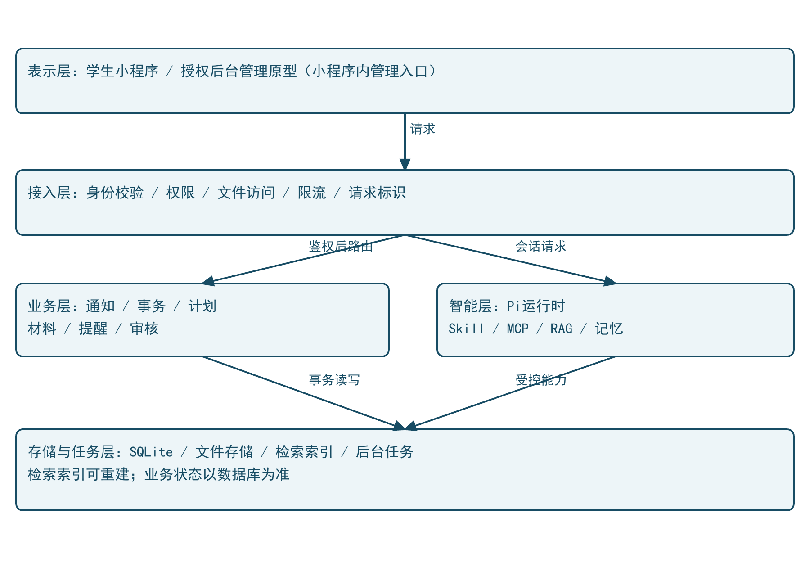
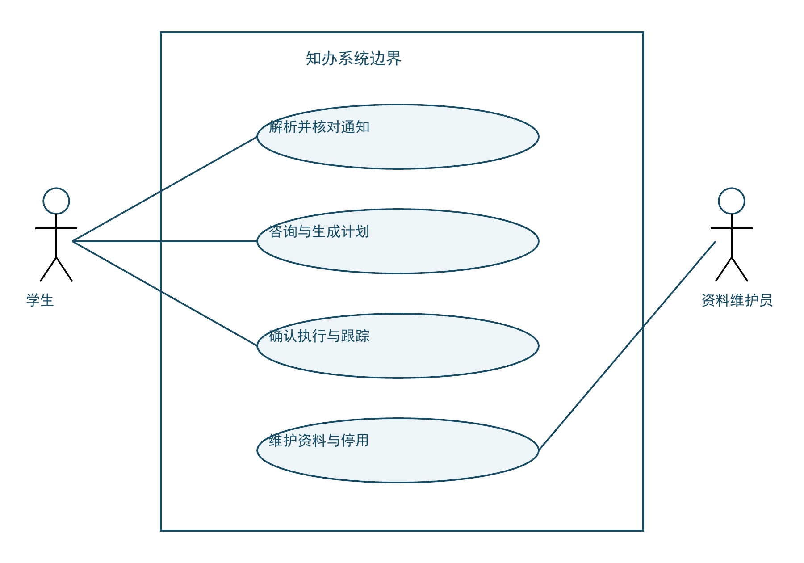
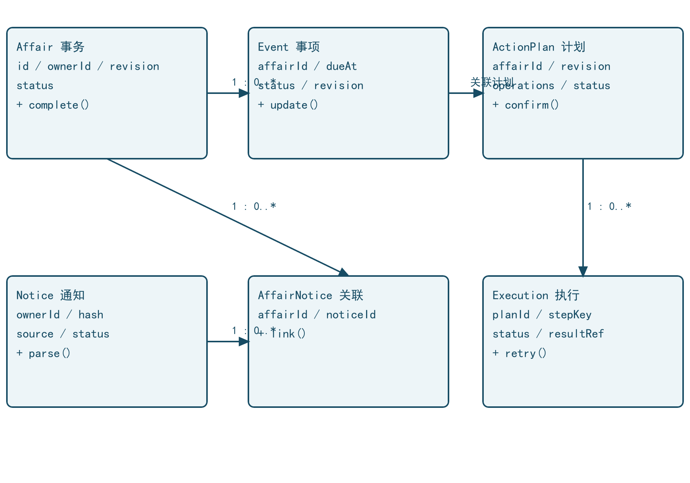
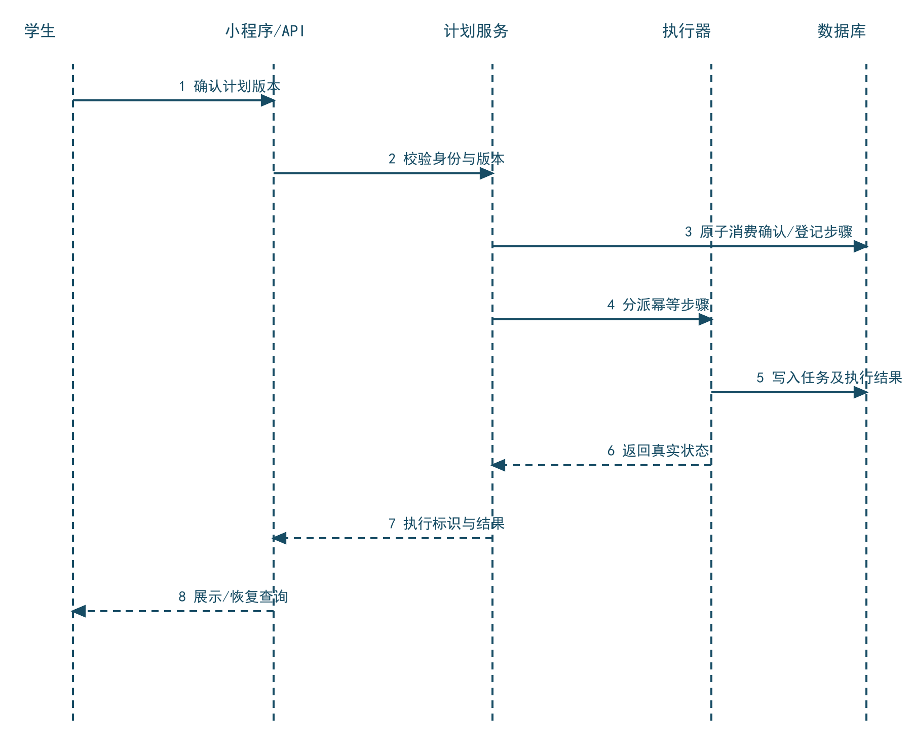

# Milk Dragon_系统设计说明书

版本3.4 / 2026-11-22 / 设计详化稿

## Milk Dragon 系统设计说明书

文档标识 ZB-SSDD-3.4 / 2026年11月22日 / 设计详化稿

团队：林炳辉（产品文档）、黄国轩（智能体）、吴俊达（前端）、谢嘉鸿（后端）、张志远（测试）。

本次设计交付包括即时设计17页原型、五类UML图及数据库设计。原型覆盖12页学生端与5页管理端。11月22日复核验证通知变更、确认调整、结果及返回首页的完整演示路径。

阅读索引：第1至8章介绍设计基线、架构与UML。第9至14章说明接口、原型、部署与需求追踪。第15至21章详述模块职责、解析核对、智能体、确认执行、变更、权限与验收。

版本记录：V3.2完成原型公开预览与说明。V3.3同步17页交互与关系模型。V3.4补齐可供实施的接口、状态、权限及验收细节。

## 1 引言、参考与缩略语

参考：GB/T 8567—2006《计算机软件文档编制规范》。国家标准平台：https://openstd.samr.gov.cn/bzgk/std/newGbInfo?hcno=84C42B6277D2714B7176B10C6E6B1A44 。按系统/子系统设计与数据库顶层设计主题裁剪组织，未声称逐条符合性认证。公开需求基线为第一次作业博客https://www.cnblogs.com/embrace897/p/23594772（2026-11-21核对），沿用FR01—20及原优先级；V2.0报告为辅助材料；本设计为V3.4详化稿。

UML（Unified Modeling Language，统一建模语言）；ER（Entity Relationship，实体关系）；API（Application Programming Interface，应用程序接口）；RAG（Retrieval-Augmented Generation，检索增强生成）；MCP（Model Context Protocol，模型上下文协议）；Skill（场景处理规范）；PK（Primary Key，主键）；FK（Foreign Key，外键）；ORM（Object Relational Mapping，对象关系映射）；DDL（Data Definition Language，数据定义语言）；UTC（Coordinated Universal Time，协调世界时）；WAL（Write-Ahead Logging，预写日志）；CAS（Compare And Set，比较并更新）；JSON（JavaScript Object Notation，数据交换表示）。 FR（Functional Requirement，功能需求），P0/P1/P2（核心、次优先、扩展），ID（Identifier，标识），PDF（Portable Document Format，便携式文档格式），UI（User Interface，用户界面），HTTPS（Hypertext Transfer Protocol Secure，安全超文本传输协议），SQL（Structured Query Language，结构化查询语言），P95（第95百分位）。SSDD为系统及子系统设计说明书的文档标识缩写，DB为Database（数据库）。

设计输入：知办需求V2.0；第二次团队作业16785。本文按架构、模块、对象与接口逐层展开。后台管理按本次作业新增设计，小程序仍是唯一学生产品，不新增学生Web。

## 2 基线与总体决策

业务闭环：通知上传、字段核对、事务关联、检索咨询、计划、确认执行、材料与提醒、通知变更、人工办结。

核心场景为竞赛报名、课程材料提交。后台管理原型覆盖资料发布/停用、异常任务和审计；实现优先采用小程序授权管理入口。

采用TypeScript/Hono服务、Pi执行体系及uni-app/Vue小程序。单体分层服务加后台进程，SQLite单实例试点与持久化附件。MiniClaw仅静态评估，复用能力先验证。

不直接执行任意命令，不代缴费、不代外部提交。资料未知时追问。模型调用不持有数据库事务。

## 3 分层架构

表示层只发请求；接入层确定用户与范围；业务层持有规则；智能层提出计划；工具仍经业务服务鉴权；后台按数据库状态处理异步任务。

模块边界：NoticeService处理草稿与依据；AffairService处理事务；PlanService处理确认；Executor处理幂等步骤；KnowledgeService过滤资料；ReminderWorker处理提醒。

## 4 UML用例设计

学生关联通知、咨询、确认计划与查询结果；资料维护员维护公共资料。系统管理员另负责部署配置，不隐式查看私人原文。

关键写入只接受服务端确认记录。普通查询无需逐次确认，用户直接表单保存即为明确操作。

## 5 UML活动设计

初始实心圆、动作圆角框、判断菱形、终止双圆。即使无歧义也经过用户核对；只有确认后才保存正式事项。

解析失败保留通知，支持手动录入。相对时间必须有基准，日期未知不得补成确定值。

## 6 UML类结构

图为核心子集。事务与通知由关联类连接；事务含多个事项；计划含多个执行步骤。完整数据库关系见数据库说明书。

revision用于并发校验，业务对象的ownerId由服务端身份确定。计划记录目标版本，模型不得直接修改表。

## 7 关键算法时序

确认接口保存操作者、计划版本和操作摘要。执行接口再次校验计划与关联目标的版本，在同一短事务内消费确认并登记步骤，后台处理完成后可按步骤标识查询。

执行器按唯一step_key领取任务。内部业务写入与结果记录同一事务；外部生成按稳定请求标识核验，结果不明标记待核实。计划变更或目标过期则返回409，不执行旧方案。

## 8 UML协作设计

1表示确认，2表示提交执行，3表示后台领取，4表示查询进度。小程序经计划服务读取状态和产物。

系统对外显示成功、部分成功、失败与待核实。取消仅影响未执行步骤，不把已成功写入当作撤销。

## 9 接口与数据契约

| 接口 | 输入与结果 |
|---|---|
| POST /api/notices | 上传文件或原文，成功受理返回202及noticeId |
| GET /api/notices/:id | 返回本人通知、解析状态及当前草稿版本 |
| POST /api/notices/:id/confirm | 草稿版本、人工修正值及关联对象，返回事务与已保存事项 |
| POST /api/affairs/:id/plans | 提出需求与时间约束，返回计划标识、版本及待确认操作 |
| POST /api/plans/:id/confirm | 提交planRevision与摘要，返回confirmationId |
| POST /api/plans/:id/execute | 提交confirmationId，返回202及executionId |
| GET /api/executions/:id | 由执行步骤定位计划，返回聚合状态、分步结果及产物 |
| POST /api/affairs/:id/compare | 提交补充通知标识，返回差异与候选计划 |
| POST /api/knowledge-documents/:id/publish | 维护范围校验通过后登记发布，索引就绪后可检索 |

错误：400输入不合法，401会话失效，403无权，409版本冲突，413超限，429配额，502/504上游异常。返回requestId，不泄露密钥。

相同执行请求按计划版本与操作计算稳定步骤键。服务先核对所属用户，再查询是否已登记相同步骤。重复请求返回既有步骤标识。首次执行时在短事务内消费确认并登记步骤，确认版本失效返回409。

通用返回包含requestId。失败统一返回错误代码和安全提示。详情接口从会话推导用户身份，客户端提供的ownerId不参与授权。

## 10 前台与后台原型规则

即时设计含12个学生画板和5个管理画板，尺寸390×844。原型使用示例数据，重点演示通知核对、确认执行、变更影响与资料审核。

前台页面：S01首页，S02上传，S03核对，S04事务，S05助手，S06计划确认，S07执行结果，S08变更对比，S09记忆，S10消息。后台：A01概览，A02资料列表，A03资料审核，A04执行异常，A05审计。 学生端补充S11确认调整和S12变更结果。

预览主线为S01→S02→S03→S04→S05→S06→S07。通知变更演示为S01→S08→S11→S12→S01。审核路径为A01→A02→A03→A02。五栏图标标识当前栏目。

核对屏按字段展示原文；未知日期阻止对应日程落库。计划卡列出新增/修改目标。异常屏只重试安全步骤。后台发布需来源与有效范围，停用立即排除新检索。

[打开即时设计公开预览](https://js.design/v?i=GHij-B&p=WOFdw0OL2p&f=PujeSk_V9qCFzCgrZPzh6)

## 11 运行、安全与部署

部署：HTTPS接入、业务进程、执行进程、单实例数据库、文件目录及备份。模型凭证仅服务端；文件接口逐次鉴权。SQLite外键开启，WAL支持读写并发，长模型任务不占锁。

权限与检索先过滤再排序；通知和文档是数据，不能授权工具。使用配额、超时及步数上限；审计仅保存动作摘要。

后台提醒到时入库，小程序再次进入可见，不等同微信推送。订阅消息规则待核实，不做本期必交依赖。

恢复：执行租约超时进入重核验；生成结果不明不盲重试。每日一致性备份数据库与附件清单，上线前恢复演练。

## 12 追踪、评审与未决事项

| 需求 | 模块/设计 | 验证 |
|---|---|---|
| FR02-04 | 通知/活动图 | 日期歧义、截断与核对 |
| FR07-09 | 检索/Skill/记忆 | 有效资料引用与约束 |
| FR10、16 | 计划/时序与协作 | 并发重复、旧版本、中断恢复 |
| FR12-15 | 文件/变更服务 | 生成文件、偏好删除、差异 |
| FR17-19 | 后台/权限/审计 | 停用资料、越权与删除 |

设计评审检查：六类图是否互相一致、计划状态是否闭合、数据库约束是否可执行、原型能否走通杀手级流程。

作业历史：设计阶段截止于2026年11月22日23:59，依据课程平台。后续评审需要真实协作记录与成员贡献链接。MiniClaw运行、部署主体与模型预算仍待项目开发阶段验证。

## 13 与首次博客的需求承接与设计补全

需求基线见第一次团队作业博客：https://www.cnblogs.com/embrace897/p/23594772。

已公开事实：Milk Dragon五名成员及角色不变；博客记载询问30人并归纳提醒、通知整理、竞赛规划、复习辅助四类需求。该人数作为团队自述，不扩写满意度、问卷比例或已验证效果。

首批仍为竞赛报名、课程材料提交。复习辅助仅作为同一事务咨询能力的后续适配，不新增独立考试题库模块。保留FR20订阅提醒与日历导出为P2，不提前承诺微信主动推送。

正式事项通过event_sources保存原草稿、字段依据及用户确认值；生成材料通过artifacts关联事务、执行与真实文件。活动保留start_at/end_at，未知结束时间不判定确定冲突。

日程冲突：已知区间[a,b)与[c,d)满足a<d且c<b时冲突；缺少终点只能提示待确认。截止节点不等同占时活动。

查询路径：原通知及当前事务→实时日程→按机构/部门/人群/有效期筛选已发布且索引就绪资料→确认记忆。引用返回documentId、版本、片段与定位；信息不足则追问。

记忆、会话和Skill复用MiniClaw时通过适配层关联当前事务与用户范围；尚未验证适配，不能把“记忆全文搜索”写成已完成文档RAG。

## 14 原型、权限与验收矩阵

| 需求基线 | 原型/服务/存储 | 验收重点 |
|---|---|---|
| FR02—04 | S02/S03 / NoticeService / drafts,event_sources | 模糊截图、缺年、确认值与原文可回溯 |
| FR05—06 | S04 / AffairService / events,checklist_items | 活动起止、日期精度与冲突 |
| FR07—09 | S05/S06 / Agent、KnowledgeService | 机构有效期过滤、引用及个人约束 |
| FR10、16 | S06/S07 / PlanService / confirmations,executions | 拒绝不执行、旧版409、幂等、恢复 |
| FR12—15 | S07—09 / artifacts,memory_items,changes | 产物可访问、偏好删除、变更影响 |
| FR17—19 | A02—05 / knowledge_documents,audit_logs | 停用即时排除、越权拒绝、删除影响 |

本次不要求现场答辩。交付门槛为设计文档及即时设计真实分享链接；协作过程与本人GitHub贡献必须补真实记录，第一次作业合照不当作本次新协作证据。

## 15 模块职责与调用边界

| 模块 | 职责与输入 | 输出及数据所有权 |
|---|---|---|
| NoticeService | 接收通知及来源，恢复待解析记录，管理草稿版本 | 可核对草稿、字段证据。写notices、drafts |
| AffairService | 校对后建立事务，维护事项、材料与办理状态 | 事务视图。写affairs、events、checklist_items及关联表 |
| AgentService | 组织会话、检索与意图处理，生成结构化建议 | 带出处建议、计划候选。不接受模型指定身份或直接执行写入 |
| PlanService | 维护方案版本，校验计划与目标，登记确认和执行步骤 | 计划与执行标识。与业务服务共享短事务 |
| Executor | 领取步骤、校验工具输入、记录结果并处理安全重试 | 分步状态、产物引用。业务写入交相应服务 |
| KnowledgeService | 校验维护范围与资料出处，管理版本、发布及索引 | 可引用片段。写knowledge_documents、knowledge_chunks |
| ReminderWorker | 定时扫描到期且仍有效的提醒 | 站内通知保存在reminders，用户读取后标记read_at |

部署采用一个逻辑业务服务与同主机后台进程。小程序通过统一接入层调用，Agent通过受控接口使用业务能力。模型、工具及附件读写在数据库写事务之外完成。

## 16 通知解析、人工核对与来源追溯

上传校验格式、大小与来源后保存原文，登记为pending并返回noticeId。小程序以该标识查询进度。试点由单一解析工作进程扫描pending记录，按通知版本提交草稿。进程中断后仍可扫描，版本和草稿唯一约束拦截重复提交。

| 规则 | 落地设计 | 预期界面 |
|---|---|---|
| 原始来源 | 保留用户填写的来源和发布时间。扫描件记录页码或片段定位 | 每个关键字段可查看原文依据。精度不足标为待核对 |
| 日期歧义 | 先用明确的通知时间与事件时区解释相对日期。缺少年份、时间基准或存在两种解读时保留未知 | 请用户补充。不得凭模型结果安排精确提醒 |
| 人工修改 | 提交当前草稿版本及修正值，业务层校验后登记确认值与原文定位 | 并发展开旧草稿返回409，提示刷新核对 |
| 解析失败 | 保留原文和失败状态。重试前检查文件仍可访问，或由用户手工创建核对草稿 | 显示可恢复的失败说明与下一操作 |

示例：通知只写「下周五交材料」，缺少可验证发布时间。草稿显示“待补充”，站内提醒保持未配置。补入明确时间并确认后才写入正式事项；可在详情回看原片段及确认值。

## 17 智能体编排、资料引用与工具调用

| 阶段 | 输入与筛选 | 输出及失败处理 |
|---|---|---|
| 会话定位 | 使用登录身份和已授权事务标识读取原文、办理状态及选中约束 | 越权请求终止。找不到适用事务时询问用户 |
| 场景Skill | 按竞赛报名或课程材料提交选择规则，包括需要核验的字段、允许的工具与缺项处置 | 输出带结构的处理流程。场景不明确时先澄清 |
| RAG检索 | 只搜索已发布、索引就绪、有效期及机构范围匹配的资料 | 返回资料标识、版本和定位。冲突并列展示并要求核验 |
| 偏好记忆 | 装载当前用户已确认的长期偏好，单次对话约束只在本次会话使用 | 用户可查看、停用和删除。已删除偏好从新请求上下文排除 |
| 工具与确认 | 读工具经过权限与参数检查。写操作先转成计划，在确认有效后由执行器调用白名单工具 | 返回工具结果和产物引用。超时或结果不明进入安全恢复流程 |

工具登记包含名称、输入模式、读取或写入类型、允许角色和重试策略。MCP用于接入审核通过的工具。资料片段和用户上传文本只能作为内容，服务在调用前独立鉴权并校验操作参数。

资料库不可用时，可以使用用户提供的通知及已授权数据继续解释，列出缺少的官方依据。确定性不足时不代替用户确认。工具未成功返回的文件不展示为已生成。

## 18 计划版本、异步执行与恢复

首次提交执行时，服务在同一短事务内核验方案版本和每个目标版本，消费确认并登记所有步骤。登记后冻结该计划行的版本与操作，后续调整新建计划。执行读取沿用原计划快照。

| 情况 | 服务器处理 | 小程序反馈 |
|---|---|---|
| 重复确认 | 对相同计划版本返回同一确认，摘要不符时要求重新确认 | 保留当前操作清单 |
| 重复执行 | 核对用户与确认绑定关系，若已完整登记，返回既有executionId | 继续查询原结果，避免重复任务 |
| 旧版本首次执行 | 未登记且计划或目标版本已变化时返回409 | 刷新差异并重新确认 |
| 后台领取 | 只领取排队的步骤，原子登记租约。持有租约者才可回填，等待外部服务时释放数据库写锁 | 显示排队或处理中 |
| 部分完成 | 内部写入和成功状态原子提交。仅重试明确可重试的失败步骤 | 逐项显示成功、失败、待核实及产物 |
| 外部结果不明 | 按稳定请求标识核实，核实前进入待核实状态 | 暂停该步骤的重试入口 |

executionId取已登记计划中第一项操作的步骤标识。按该标识查询时读取所属计划，按固定操作顺序聚合各步。前台重新进入可通过已授权计划查回标识。

## 19 杀手级功能详例：通知变更影响分析

示例链路为S01→S08→S11→S12。补充通知把报名截止从11月30日18:00改到11月28日18:00，并新增导师签字材料。差异由新旧通知产生，影响对象来自用户现有事项与清单。

| 数据变化 | 影响判断 | 确认后执行 |
|---|---|---|
| 报名截止提前2天 | 原报名截止事项仍未完成且来源可对应 | 更新截止时刻及该事项版本 |
| 材料检查需要提前 | 关联检查事项及其待触发提醒仍有效 | 将检查时刻改至11月27日20:00，重算未触发提醒 |
| 新增签字材料 | 确认现有清单无同一签字待办 | 新增一项待办，等待学生线下办理后勾选 |
| 既有报名表已完成 | 已完成，且补充通知无要求替换 | 保留原完成状态和历史记录 |

影响不明时先让用户选择关联事务。确认页逐项显示旧值、新值、出处及计划版本。取消返回保留原计划。只有服务端确认后才能更新记录。结果页区分已更新、仍待办理、失败或待核实。

## 20 权限矩阵与运行检查

| 能力 | 学生 | 资料维护员 | 系统管理员 |
|---|---|---|---|
| 通知、会话、事务 | 本人范围 | 本人范围 | 本人范围 |
| 确认与执行 | 本人计划，明确确认 | 同左 | 同左 |
| 知识资料 | 检索有效公开资料 | 维护授权范围内的公共资料 | 维护服务配置 |
| 异常与审计 | 查看本人执行 | 查看授权资料操作和最小排障信息 | 查看运行指标和按权限限定的审计 |

文件下载验证文件归属和关联对象状态，每次请求重新鉴权。发布及停用记录操作者、动作、目标、请求标识与必要摘要。日志记录处理阶段及错误类别，屏蔽原文、密钥和完整工具参数。

监测指标包括解析积压、最老待执行步骤、失败类别、待核实数量和文件读写错误。试点上线前在隔离环境用公用测试数据验证服务重启、积压恢复及文件下载权限。

## 21 场景验收与迭代顺序

| 用例 | 触发 | 通过条件 |
|---|---|---|
| SY-01 原文可追溯 | 通知缺日期，用户补正后确认 | 事务详情展示正确值和依据。未确认时无正式提醒 |
| SY-02 资料适用性 | 资料已停用、过期或属于其他院系 | 本次问答未引用这些资料，缺依据时提示核验 |
| SY-03 防止重复执行 | 点击两次确认执行，随后重新打开小程序 | 登记的步骤数量与已选操作相同，恢复同一执行结果 |
| SY-04 旧版本冲突 | 确认后另一设备修改报名截止，再提交执行 | 首次执行返回409，旧计划未写入事项 |
| SY-05 通知变化 | 截止提前且新增材料 | 只更新受影响的截止、检查提醒和清单，已完成项保留 |
| SY-06 权限隔离 | 另一用户请求文件、执行记录或管理操作 | 无权限响应且无数据变化，日志可追踪 |

首个可演示版本先交付通知核对、事务清单、变更影响与确认执行。Agent工具与资料范围通过集成验证后扩展。上述用例为设计验收目标，在线画板用于验证页面跳转。
