# 第二次团队作业——原型设计+概要设计

| 项目 | 内容 |
|---|---|
| 作业所属课程 | [软件工程课程](https://edu.cnblogs.com/campus/gdgy/Class78-Grade2024-CS) |
| 作业要求 | [第二次团队作业](https://edu.cnblogs.com/campus/gdgy/Class78-Grade2024-CS/homework/16785) |
| 作业目标 | 完成知办前台和后台原型，以及系统架构、UML与数据库设计，明确关键流程和接口，为四周开发与杀手级功能实现建立可检查的设计基线。 |
| 团队名称 | Milk Dragon |
| 团队成员学号-名字 | 3124004430-林炳辉；3124004426-黄国轩；3124004443-吴俊达；3124004444-谢嘉鸿；3124004453-张志远 |

> 2026年11月22日设计复核，版本V3.3。第二次作业截止时间为11月22日23:59。四周计划用于后续项目开发。[课程平台](https://edu.cnblogs.com/campus/gdgy/Class78-Grade2024-CS/homework/16785)

## 一、项目与本次设计范围

知办是面向大学生的校园事务智能体小程序，帮助学生读懂通知、继续提问、制定方案、准备材料并跟踪变化。首期竞赛报名与课程材料提交两个场景，杀手级功能为“通知到办结”，尤其是补充通知对个人已有计划的影响分析。

学生成品仍为微信小程序。本次按作业要求补充后台管理原型：资料发布/停用、执行异常和审计。后台采用小程序授权管理入口，不新增独立学生Web网站。若教师明确要求桌面后台，再调整画布与实现范围。

### 需求承接

前期成果以[团队项目第一次作业](https://www.cnblogs.com/embrace897/p/23594772)为公开基线。第一篇已记录30人初步询问，归纳事务提醒、通知整理、竞赛规划与复习辅助；本次沿用该团队调研表述，原始访谈记录待补档，不虚构统计比例和新增样本。

| 前期确定内容 | 本次设计落实 |
|---|---|
| 微信小程序为唯一学生端 | S01—S12学生原型；后台采用授权管理入口A01—A05 |
| 首期竞赛报名与课程材料提交 | 两场景共享事务、清单、计划和工具执行 |
| 原文核对与来源可信 | drafts保留版本，event_sources保存正式字段依据及确认值 |
| RAG、记忆、Skill与工具 | 检索有效资料、确认长期偏好、按场景规划、受控执行 |
| 通知变更影响个人安排 | changes记录差异，plans经确认调整events及reminders |
| 文件产物真实可查 | artifacts关联执行、事务和实际files，不仅回复文件名 |
| 优先级P0/P1/P2 | 沿用FR01—20；微信订阅消息和日历导出仍为P2 |
| 五人分工 | 延续首次博客角色，细化本次预期产出，不冒写真实贡献 |

复习辅助在首次调研中出现，但首批范围仍是上表两类场景；本次不新增独立题库或考试系统。后台原型是课程设计要求的补充，不把产品改为双端网站。本次不要求现场答辩。

## 二、术语、设计依据与版本

FR为功能需求，P0/P1/P2分别表示核心、次优先和扩展，UI为用户界面，PDF为便携式文档格式。UML为统一建模语言；ER为实体关系；API为应用程序接口；RAG为检索增强生成；MCP为模型上下文协议；Skill为场景处理规范；PK/FK为主键/外键；ORM为对象关系映射；DDL为数据定义语言；Pi为所复用的Agent执行体系名称；Agent指智能体。完整缩略语见说明书第1章。

参考[GB/T 8567—2006《计算机软件文档编制规范》](https://openstd.samr.gov.cn/bzgk/std/newGbInfo?hcno=84C42B6277D2714B7176B10C6E6B1A44)，按系统设计与数据库顶层设计主题裁剪，不宣称逐条认证。公开需求输入为第一次作业博客第三部分FR01—20，V2.0本地报告为辅助资料；本次设计版本为V3.3。

## 三、原型设计

### 3.1 工具、页面与交互

选用**即时设计**，已建立前台12页与后台5页，画板390×844；统一深青色标题、卡片、按钮与底部导航。使用可编辑矢量图层，并在专用工具中配置跳转。详细规则见[原型设计与验证说明](https://github.com/embrace897/zhiban/blob/main/docs/assignment-2/%E5%8E%9F%E5%9E%8B%E8%AE%BE%E8%AE%A1%E4%B8%8E%E9%AA%8C%E8%AF%81%E8%AF%B4%E6%98%8E.md)。下表为目标业务流程；本次原型用虚构数据演示，交互覆盖范围见3.3节。

| 前台路径 | 处理结果 |
|---|---|
| 首页→上传→核对→事务 | 从原通知建立正式事项与材料清单 |
| 事务→助手→计划确认→执行结果 | 有来源的个人方案转为真实任务及产物 |
| 首页通知变化→变更对比→确认调整→变更结果 | 展示新旧值及受影响任务，确认后调整 |
| 我的→记忆维护 | 用户控制长期信息，不自动保存临时约束 |

| 后台路径 | 处理结果 |
|---|---|
| 概览→资料列表→审核→发布/退回 | 资料带来源、版本、机构与有效期 |
| 概览→执行异常 | 显示部分成功、失败或待核实，仅安全重试 |
| 概览→审计 | 记录操作者与动作，不默认展示私人正文 |

### 3.2 原型突出特点

核对页让每个日期、材料对应原文；计划页提前展示写入对象及变化；执行页区分真实成功与部分失败；变更页将通知修改映射到个人安排。设计加载、空态、失败、无权和断线恢复，重要信息同时用文字表达。

学生端使用原文核对、带依据的计划以及确认执行三步串联通知处理。底部五栏通过图标和高亮标识当前位置。

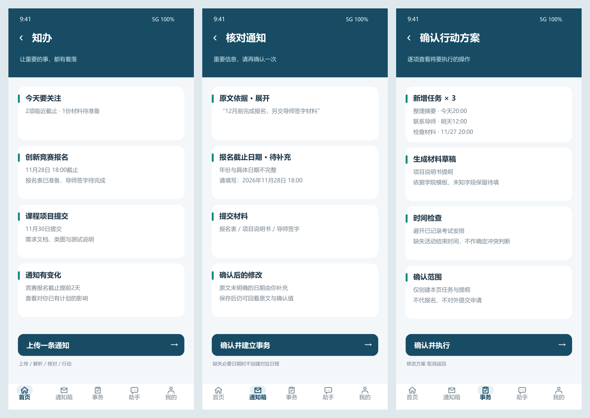

竞赛报名截止从11月30日18:00提前到11月28日18:00，材料检查相应提前两天。确认页列出需要调整的时间、提醒和新增的导师签字事项，结果页标明已更新内容及仍需学生办理的待办。

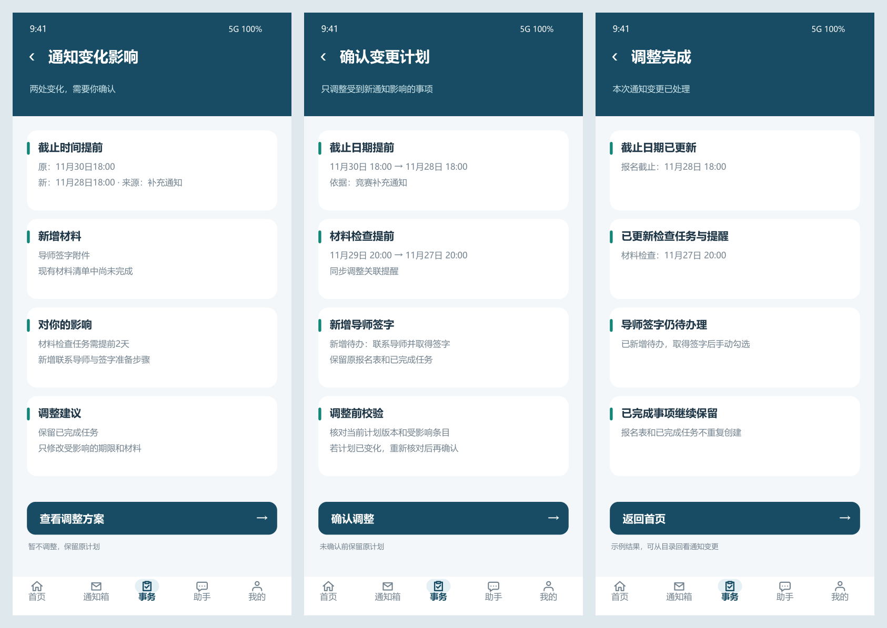

资料维护员在管理工作台进入审核和异常处理。审核页汇总来源、范围与有效期，异常页区分可安全重试与结果待核实。

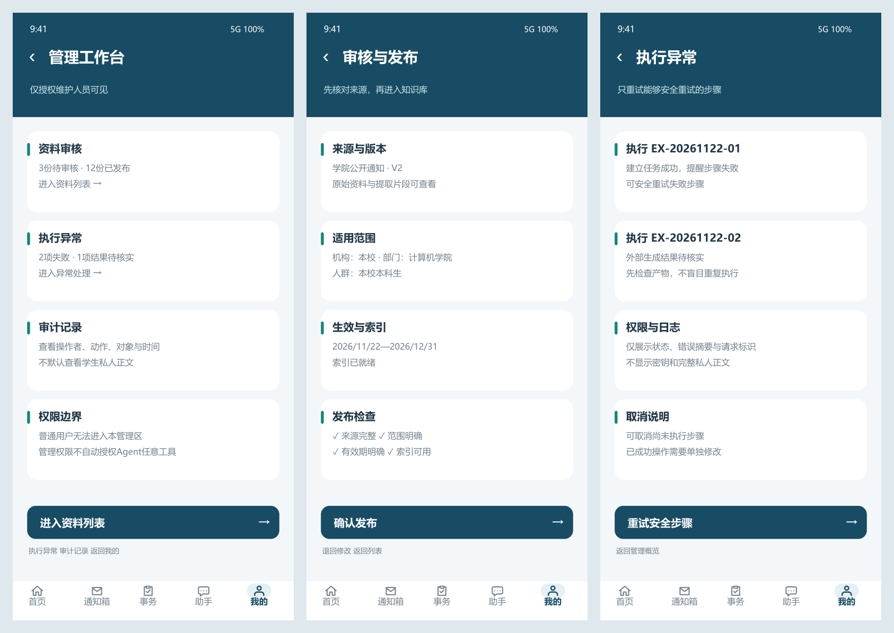

以上插图由可编辑画板素材导出，点击演示请使用下方预览。

### 3.3 在线展示状态

- [即时设计公开预览](https://js.design/v?i=GHij-B&p=WOFdw0OL2p&f=PujeSk_V9qCFzCgrZPzh6)：无需加入团队即可查看，左侧目录可选择全部17页。
- [原型源文件](https://js.design/f/GHij-B?mode=design&p=WOFdw0OL2p)：团队继续维护可编辑页面与交互，编辑权限由所有者管理。
- [可编辑SVG页面素材](https://github.com/embrace897/zhiban/blob/main/docs/assignment-2/prototype-assets)：用于备份和二次调整。

2026年11月22日，已用未登录的Edge无痕窗口打开首页并进入管理页面。已验证主按钮路径：首页→上传→核对→事务→助手→确认→执行结果；首页“我的”→个人中心→管理工作台→资料列表→审核页；工作台执行异常入口。新增分支已实点验证：首页「通知有变化」→S08「查看调整方案」→S11「确认调整」→S12「返回首页」。

当前为交互演示：示例日期、材料和执行结果用于说明产品规则。输入表单、完整底部导航、重试成功反馈、真实文件下载及授权拦截需继续细化，不能将页面跳转当成后端能力已实现。原型左侧管理页目录仅为课程评审展示，成品仍需服务端鉴权。

## 四、概要设计：从架构到对象

### 4.1 架构与功能模块

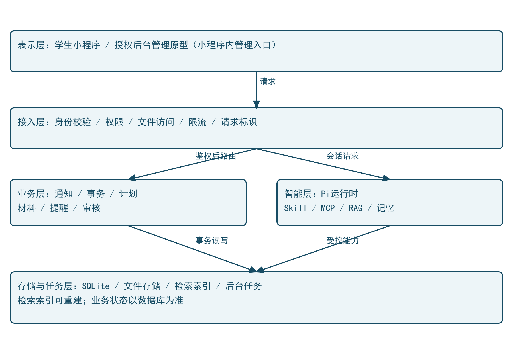

表示层负责交互；接入层确定身份、范围和限额；业务层实现通知、事务和计划；智能层按任务选择Skill、资料与记忆；数据层保存真实状态，任务进程异步解析、生成与提醒。模型调用不占数据库写事务。

### 4.2 用例图

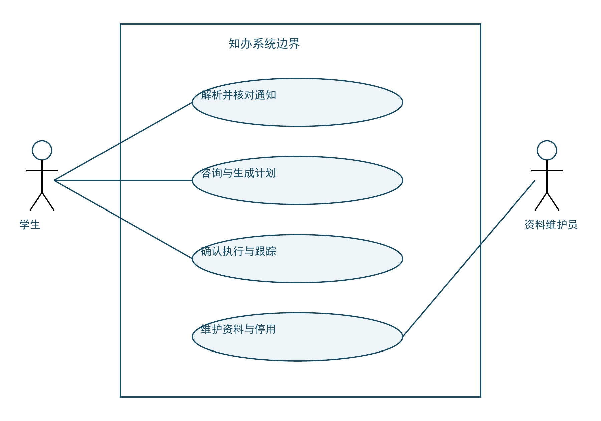

学生完成通知与事务处理，资料维护员负责公共知识发布和停用。普通用户不能通过助手获得管理员工具权限。

### 4.3 活动图

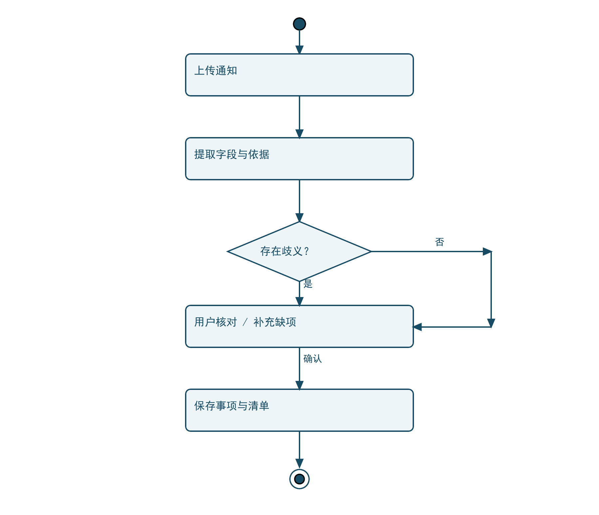

缺项进入追问或编辑，无缺项也必须经过核对；解析失败保留草稿并允许手工录入。用户确认后才建立正式事项。

### 4.4 类图

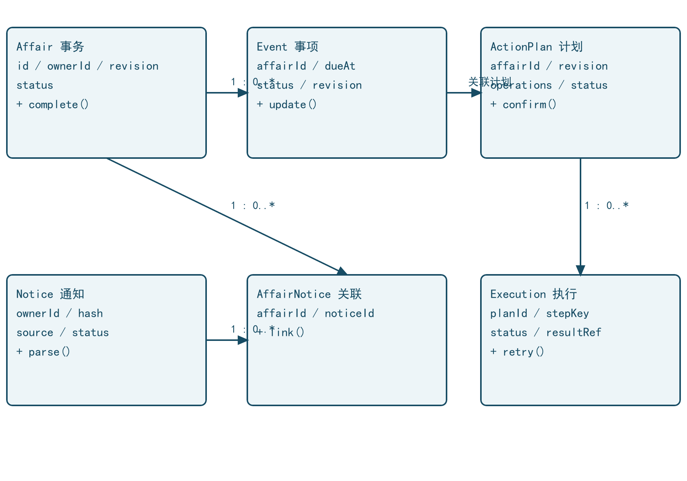

事务与通知通过关联类形成多对多；事务含事项，计划含执行步骤。图为核心结构子集，完整字段与关系见数据库说明书。

### 4.5 时序图：计划确认与幂等执行

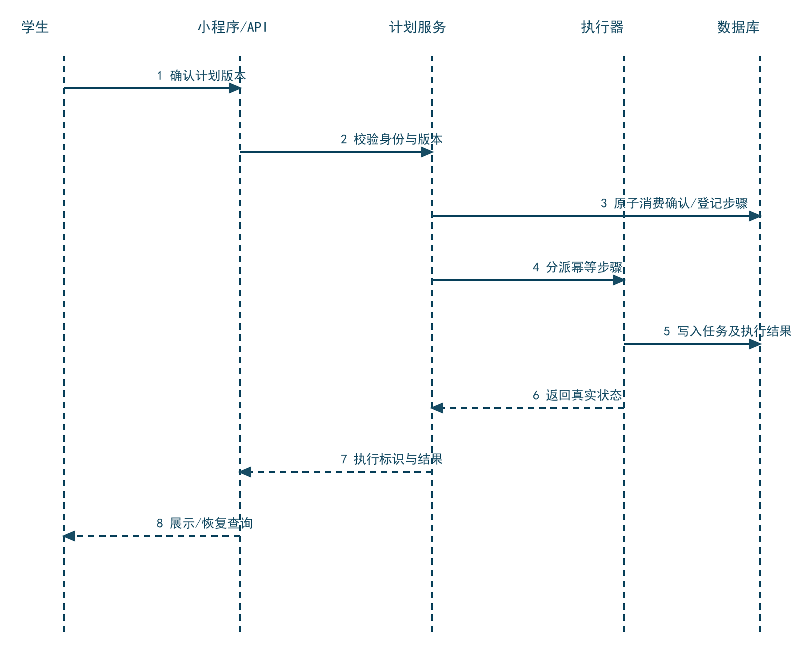

确认绑定计划与目标版本，服务端短事务内消费确认并登记稳定步骤。内部写入与执行结果一起提交；外部结果不明转待核实，不能盲重试。原确认失效时重新核对。

### 4.6 协作图

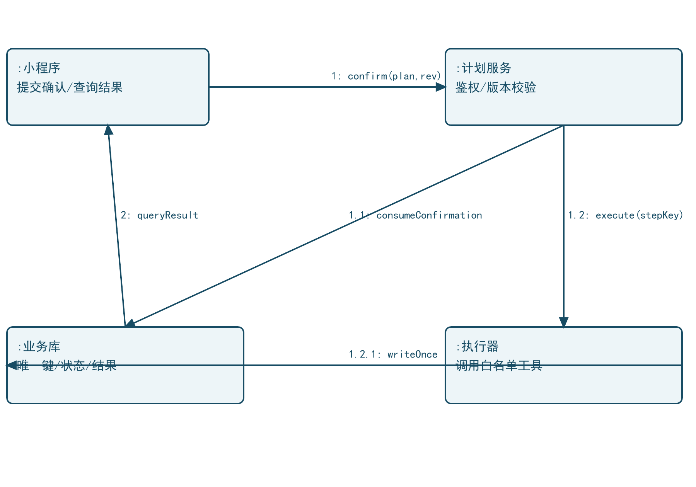

协作消息1表示方案确认，2表示提交执行，3表示后台领取步骤，4表示查询执行进度。小程序通过计划服务查询结果。更细的接口、状态和错误码见系统设计说明书。

## 五、数据库设计

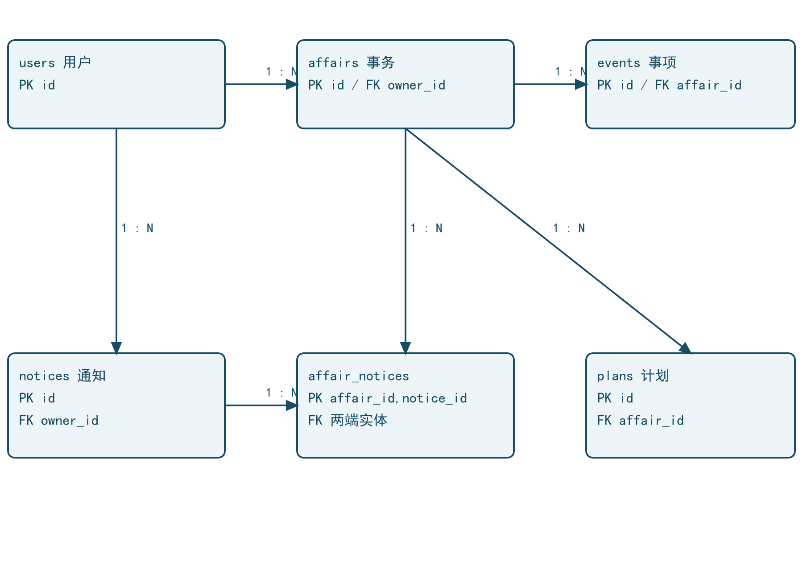

概念图以1:N标注基数，通知与事务通过中间表连接。完整设计19表：用户、文件、通知、草稿、事务、事务通知关联、事项、清单、计划、确认、执行、提醒、知识文档、知识分段、记忆、变更、审计、正式字段依据和生成产物。

关系模型按19张表列出主键、外键及其引用目标。确认按计划版本唯一，执行step_key唯一防止重复登记。时间区分日期型、精确型和未知型。数据库说明书分别给出关系模型、19个类表映射及关键属性转换示例。

ORM映射采用实体与snake_case表字段对应，Repository显式映射；复杂操作和证据按校验后的JSON保存。活动新增起止时间，未知结束时间不强行判断冲突；资料补齐部门、人群、生效时间和索引状态。完整实体映射和数据字典见PDF及[数据字典](https://github.com/embrace897/zhiban/blob/main/docs/assignment-2/%E6%95%B0%E6%8D%AE%E5%AD%97%E5%85%B8.json)。

[建表脚本](https://github.com/embrace897/zhiban/blob/main/docs/assignment-2/schema.sql)已在内存SQLite中成功执行并通过外键检查，仅证明结构可创建；权限、并发及业务测试仍需实现后验证。跨用户关联由服务事务验证，单列外键不能替代用户隔离。

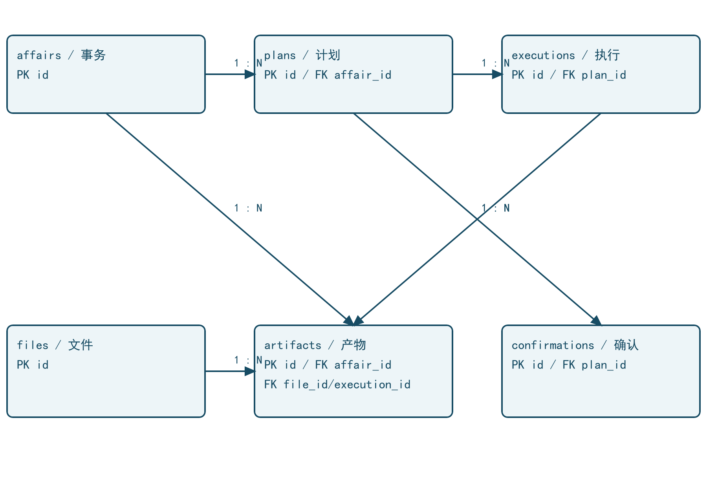

新增event_sources与artifacts是对既有需求的落库补全，详见数据库说明书第10、11章。业务19表是目标模型，整合MiniClaw时需检查命名冲突并使用独立命名空间或适配，禁止直接覆盖底座表。

## 六、团队计划与协作

### 6.1 四周计划（预期）

后续开发按11月23日至12月20日四个自然周安排。此次设计作业单独在11月22日23:59前提交。

| 周次 | 日期 | 任务 | 里程碑与产出 |
|---|---|---|---|
| 第1周 | 11/23—11/29 | 原型交互、两份设计评审、底座链路验证、数据库迁移 | M1设计冻结：原型分享、PDF、schema与接口基线 |
| 第2周 | 11/30—12/06 | 小程序登录、上传核对、事务清单、资料维护 | M2核心可用：通知到事项、权限与主链记录 |
| 第3周 | 12/07—12/13 | RAG与Skill、方案确认、工具执行、变更影响 | M3杀手级贯通：竞赛连续场景及失败分支 |
| 第4周 | 12/14—12/20 | 真机、性能、恢复、试用、修复与审核提交 | M4交付：测试证据、发布/审核真实记录、开发阶段交付记录 |

平台审核属于外部依赖，预留时间但不保证必然通过；未通过时记录真实状态。

### 6.2 五人分工（预期，待成员确认）

| 成员 | 角色 | 详细负责部分 | 评审搭档 |
|---|---|---|---|
| 林炳辉 | 产品/文档 | 原型信息结构、两份文档与博客、需求追踪、用户试用组织 | 张志远 |
| 黄国轩 | Agent开发 | Pi接入、场景Skill、MCP工具、RAG资料筛选、记忆与变更分析 | 谢嘉鸿 |
| 吴俊达 | 前端 | 学生12页、后台5页、确认卡片、上传预览、断线恢复 | 林炳辉 |
| 谢嘉鸿 | 后端 | 身份权限、19表迁移、通知事务、幂等执行、提醒与部署 | 黄国轩 |
| 张志远 | 测试 | 用例设计、schema验证、越权/重复/恢复/真机、缺陷追踪 | 吴俊达 |

### 6.3 协作与GitHub贡献证据

| 本轮记录 | 已核实内容 | 证据 |
|---|---|---|
| 设计材料归档 | GitHub账号 embrace897 提交两份设计说明书、博客和原型链接 | [设计材料提交](https://github.com/embrace897/zhiban/commit/3290fdd) |
| 原型界面修订 | embrace897 提交五栏导航图标和对应画板素材 | [原型图标提交](https://github.com/embrace897/zhiban/commit/27e2420) |
| 11月22日复核 | 工具辅助走查通知变更、调整确认和结果反馈，按在线原型修订文档 | [作业复核与待办](https://github.com/embrace897/zhiban/blob/main/docs/assignment-2/%E4%BD%9C%E4%B8%9A%E5%A4%8D%E6%A0%B8%E4%B8%8E%E5%BE%85%E5%8A%9E.md) |

以上记录以仓库提交和原型实查为依据。各成员应补充本轮实际成果的提交链接，并记录评审日期、参与人、发现的问题和结论。当前尚未取得其余成员的可归属提交及本轮团队评审记录。

## 七、文档与展示入口

- [GitHub团队仓库](https://github.com/embrace897/zhiban)
- [Milk Dragon_系统设计说明书.pdf](https://github.com/embrace897/zhiban/blob/main/docs/assignment-2/Milk%20Dragon_%E7%B3%BB%E7%BB%9F%E8%AE%BE%E8%AE%A1%E8%AF%B4%E6%98%8E%E4%B9%A6.pdf)
- [Milk Dragon_数据库设计说明书.pdf](https://github.com/embrace897/zhiban/blob/main/docs/assignment-2/Milk%20Dragon_%E6%95%B0%E6%8D%AE%E5%BA%93%E8%AE%BE%E8%AE%A1%E8%AF%B4%E6%98%8E%E4%B9%A6.pdf)
- 原型在线预览：[即时设计公开预览](https://js.design/v?i=GHij-B&p=WOFdw0OL2p&f=PujeSk_V9qCFzCgrZPzh6)。

上述文档链接指向团队仓库，图像使用仓库原图；博客园发布时建议将图片转存图床，并检查读者网络下能否加载。原型链接已补齐；仍需补齐真实团队协作记录和每人贡献证据。无需现场答辩，本次提交重点为完整且一致的设计材料。
